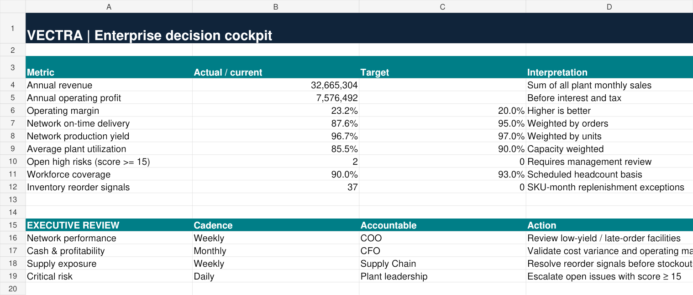
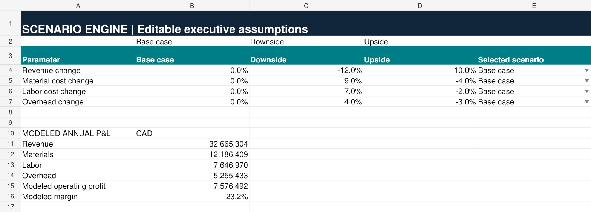
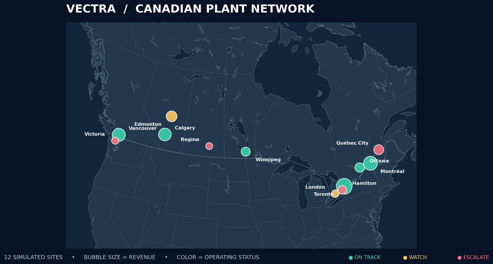

# VECTRA — Enterprise Performance & Decision Intelligence

**Excel-based manufacturing network decision intelligence · Portfolio demonstration · v0.5 (development)**

VECTRA is a multi-module Excel workbook using **synthetic business data** to connect manufacturing performance, plant profitability, workforce coverage, inventory replenishment, risk governance, scenario planning and geographic analysis.

> **Status: development / desktop verification pending.** This is a decision-support demonstration, not a production ERP. The native Excel 3D Map, Power Query/Power Pivot model, PivotTable slicers, VBA and workforce optimization are **not implemented**. Do not describe them as delivered.

## Get started
1. [Download the current workbook](workbook/VECTRA_Enterprise_Intelligence_v0.5_Enterprise.xlsx), then open it in desktop Microsoft Excel.
2. Read **START HERE**, then review **EXECUTIVE COCKPIT**.
3. Consult [the user manual](docs/USER_MANUAL.md) before editing inputs.
4. Inspect [the known limitations and validation checklist](docs/VALIDATION.md).

## Implemented modules
| Module | Current functionality |
|---|---|
| Executive cockpit | Formula-based KPI summary and scorecard |
| Finance | Monthly plant revenue, cost, profit and margin calculations |
| Operations | Production yield, delivery and capacity utilization |
| Workforce | Shift coverage and overtime exception flags |
| Inventory | SKU-level reorder-point calculations and alerts |
| Issue register | Risk scoring, status and accountable owners |
| Scenario engine | Selectable downside/base/upside driver assumptions |
| Geographic intelligence | Canadian facility metrics and a **static** plant-network map |
| Legacy dashboards | Retained demonstration views; **not reconciled** with the new detailed layer |

## Data and scope
All facilities, names, events, costs and results are fictional. The detailed model covers **12 simulated Canadian plants** and **four reporting months**. The original workbook tabs are retained for historical continuity but represent a different synthetic sample; **do not add legacy and detailed totals together**.

## Project assets
- [User manual](docs/USER_MANUAL.md) — navigation, safe editing, management workflow and troubleshooting
- [Validation checklist](docs/VALIDATION.md) — desktop acceptance checks and known limitations
- [Data dictionary](docs/DATA_DICTIONARY.md) — model entities, measures and ownership
- [Plant network preview](assets/plant-network-map.png) — static visualization, not a native Excel map

## Roadmap
- [x] Multi-module Excel workbook and simulated data
- [x] Executive cockpit and static geographic visualization
- [x] User manual and documentation
- [ ] Reconcile original and detailed data into one governed model
- [ ] Verify formulas and visual rendering in desktop Excel
- [ ] Build native PivotTables, slicers and time filters
- [ ] Implement Power Query/Power Pivot model
- [ ] Configure native Excel 3D Maps tour
- [ ] Add scheduling optimization, automated QA and optional VBA
- [ ] Capture verified screenshots from the actual workbook and prepare Upwork release

**Compatibility:** Desktop Microsoft Excel recommended. No macros are included in the current `.xlsx` release.

**License:** No license is granted unless a LICENSE file is added. Contact the repository owner before reuse.

## Workbook previews

These images are rendered from v0.5, not captured in desktop Excel. They show selected worksheet ranges; desktop layout and chart acceptance remain pending.

### Executive cockpit

### Scenario engine

### Plant network

The map belongs to the earlier geographic sample and does not reconcile to the detailed finance model. Bubble labels should be verified against the site coordinates before final portfolio publication.

**Reporting-period correction:** “Annual” labels in the current cockpit and scenario engine sum only January–April 2026. Treat those figures as four-month totals, not full-year results or annualized estimates.

See [CHANGELOG.md](CHANGELOG.md) for release contents and [assets/README.md](assets/README.md) for image provenance. Only the current workbook is included; older iterations are omitted.
